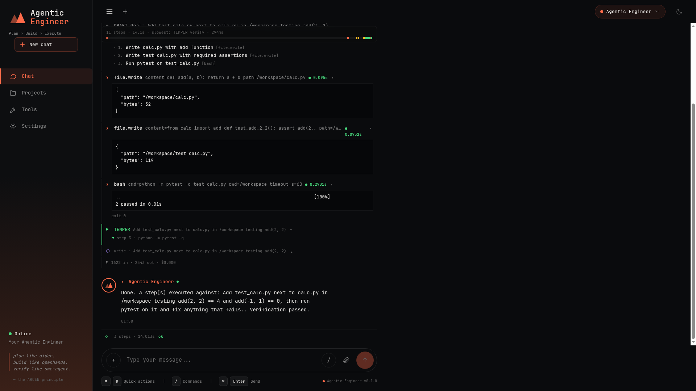
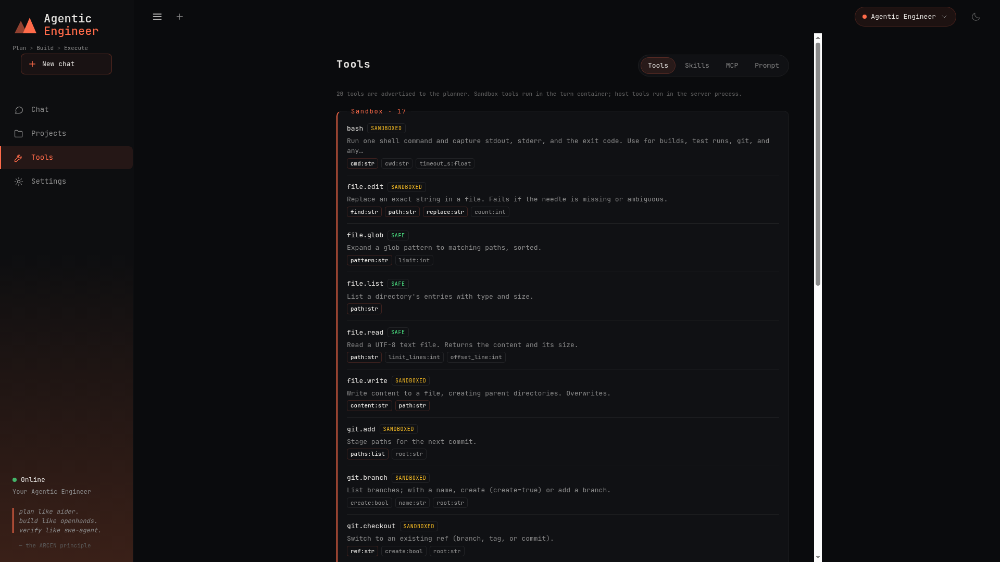

<div align="center">


# ARCEN

**Agentic reasoning. Code. Engineer.**

An agentic engineer that plans, builds, and verifies — narrating every step.

[](https://github.com/lewiseinstein15-Tech/arcen/actions/workflows/harness-validation.yml)
[](LICENSE)
[](https://www.python.org/)
[](#tests)

[Quick start](#quick-start) · [How it works](#how-it-works) · [Sandbox](#the-sandbox) · [Tools](#tools) · [Configuration](#configuration) · [Limits](#what-it-cannot-do-yet) · [Docs](#documentation)

</div>

---

## What it is

Ask for a change. Watch it get planned, made, and checked.

```
you ──▶ DRAFT ──plan──▶ FORGE ──observation──▶ TEMPER ──pass──▶ answer
          ▲                                      │
          └──────────── fail: re-plan ───────────┘
```

Three agents, no fourth opinion. **DRAFT** breaks the goal into steps and names a tool for each. **FORGE** runs exactly one step at a time and returns the raw observation. **TEMPER** tries to break the result — it runs the tests, and when there is no test command it says so instead of claiming success.

Every thought, command, and result is one JSON line on an NDJSON stream. Nothing is summarized away, so you can audit a turn afterwards, resume a session, or stop watching and read the log.



*Three steps, `2 passed`, TEMPER verified, turn `ok` in 14 s — one process, no fake progress.*

## Quick start

```bash
git clone https://github.com/lewiseinstein15-Tech/arcen
cd arcen
python -m venv .venv && source .venv/bin/activate
pip install -e ".[dev,sandbox]"
```

Pick a model — any OpenAI-compatible endpoint works, including keyless gateways:

```bash
export ARCEN_MODEL_PROVIDER=kilo
export ARCEN_MODEL_BASE_URL=https://api.kilocode.ai/api/openrouter/v1
export ARCEN_MODEL_API_KEY=""
export ARCEN_MODEL_NAME=baidu/ernie-5.5-flash-preview:free
```

Start the sandbox image once, then run:

```bash
docker pull ghcr.io/lewiseinstein15-tech/arcen-sandbox:0.1.0
npm --prefix ui install && npm --prefix ui run build   # build the web UI
arcen serve                                            # http://localhost:3002
```

Open the page, type a goal. Or stay in the terminal — each turn starts from an empty workspace, so a self-contained goal is the honest example:

```bash
arcen run "create calc.py with add(a, b), then test_calc.py asserting add(2,2)==4, then run pytest" --json
```

> **Install note.** ARCEN is not on PyPI yet, so `pip install arcen` does not work — install from the repository as above. The sandbox image *is* published (`arcen-sandbox:0.1.0` and `:latest`), or build it locally with `docker build -t ghcr.io/lewiseinstein15-tech/arcen-sandbox:0.1.0 docker/sandbox`.

### Development stack

Two shells, backend first — the Vite dev server proxies `/api/*` to port 3002 and will spam `ECONNREFUSED` if it starts first:

```bash
python -m uvicorn arcen.server.app:app --port 3002   # shell 1
npm --prefix ui run dev                              # shell 2 → http://localhost:5173
```

`./scripts/dev.sh` does both, refuses to start on occupied ports, and cleans up on exit.

### Terminal UI

```bash
pip install -e ".[tui]"         # textual client, from the same clone
arcen-tui                       # attaches to a local server, or manages one
arcen-tui --demo                # recorded events, no credentials, no Docker
```

See [docs/TUI.md](docs/TUI.md).

## How it works

### The turn

1. **DRAFT** receives a brief: the tool catalog, the skills index, and one fact about the workspace (empty or imported — see [the sandbox](#the-sandbox)). It returns 1–6 steps, each naming a tool and carrying that tool's arguments.
2. **FORGE** executes step *n*, in order, one at a time. A step that fails returns its failure — not a retry storm.
3. **DRAFT** re-plans on failure, with the failure text in hand. This is where the interesting behaviour lives: a wrong assumption gets corrected instead of repeated.
4. **TEMPER** verifies adversarially. It runs the project's tests. If it finds no test command, the turn is reported as `unverified` — never as a pass.
5. The answer is prose, and every claim in it should trace back to a step in the stream.

### The stream

The event schema is frozen at 17 types, versioned with the UI (`src/arcen/stream/events.py`). One line per event, `Content-Type: application/x-ndjson`, resumable with `Last-Event-ID`:

```ndjson
{"seq":1,"type":"run.start","run_id":"r-01J9","goal":"create calc.py and a test for it, then run pytest","depth":0,"ts":1727500000.000}
{"seq":2,"type":"think","agent":"DRAFT","text":"The workspace starts empty, so create calc.py first.","ts":1727500000.104}
{"seq":3,"type":"plan","agent":"DRAFT","steps":[{"id":1,"title":"write calc.py","tool":"file.write"},{"id":2,"title":"write test_calc.py","tool":"file.write"},{"id":3,"title":"run pytest","tool":"bash"}],"ts":1727500000.220}
{"seq":4,"type":"command","agent":"FORGE","step":1,"tool":"file.write","args":{"path":"/workspace/calc.py"},"ts":1727500000.655}
{"seq":5,"type":"command.done","step":1,"ok":true,"result":{"bytes":32},"duration_s":0.095,"ts":1727500000.750}
{"seq":9,"type":"verify.start","agent":"TEMPER","target":"/workspace","ts":1727500012.700}
{"seq":10,"type":"step.pass","step":3,"checks":["pytest -q test_calc.py  # 2 passed"],"ts":1727500014.010}
{"seq":11,"type":"answer","text":"Wrote calc.py and test_calc.py; pytest: 2 passed.","ts":1727500014.400}
{"seq":12,"type":"run.done","status":"ok","steps":3,"duration_s":14.013,"ts":1727500014.420}
```

The UI renders the same stream you can `curl`, which is why the run trace and the terminal never disagree.

## The sandbox

FORGE and TEMPER never touch your host. Each turn gets a fresh container:

| Property | Value |
| --- | --- |
| Image | `ghcr.io/lewiseinstein15-tech/arcen-sandbox:0.1.0` (pinned, must exist locally — no auto-pull) |
| Network | `none` |
| Root filesystem | read-only |
| Capabilities | all dropped |
| User | `65534:65534` (nobody) |
| Writable paths | tmpfs `/workspace` (512 MB) and `/tmp` (128 MB) |
| Host mounts | none |
| Output cap | 256 KiB per command, then the container stops |

The workspace is **disposable**. Files written in a turn are discarded when it ends, so turn 2 of a conversation does not see turn 1's `calc.py` — this is deliberate ([docs/AUDIT.md](docs/AUDIT.md)) and the planner is told so in its brief. If you want your code in there, use the local headless CLI, which snapshots a reviewed Git root and returns a host-generated patch:

```bash
arcen run "fix the failing test in tests/" --workspace . --json
arcen apply SESSION --yes        # applies the exported patch; no commit
```

Server-side, `/api/run` rejects a `workspace` field on purpose: the web UI never reads your filesystem.

**Fail-closed, not fail-open.** If Docker is missing, the image is absent, or policy validation fails, tool execution is disabled — there is no process fallback that quietly runs the plan on your host. This is a defence-in-depth boundary, not a guarantee against Docker or kernel bugs: the daemon, the image, and host-side plugins are trusted, and any data visible inside the container can leave through command output to your model provider.

Real isolation is verified against a real daemon, not mocks:

```bash
ARCEN_TEST_DOCKER_ISOLATION=1 pytest tests/test_turn_isolation.py -k real_docker
```

## Tools

Twenty tools, each with arguments generated from type hints and validated against the same schema the model was shown — the catalog cannot advertise an argument the executor refuses (there is a test for that).

Seventeen run inside the sandbox. Three run host-side (`skill.list`, `skill.load`, `server.list`) because they only read ARCEN's own indexes, never your files.

| Tool | Sandbox | What it does |
| --- | --- | --- |
| `bash` | rw | One shell command: stdout, stderr, exit code |
| `file.read` · `file.list` · `file.glob` · `search.text` | read | Read a file, list a directory, expand a glob, regex search with line numbers |
| `repo.map` | read | Ranked skeleton (paths, line counts, top symbols) for large repos |
| `git.status` · `git.diff` · `git.log` · `git.show` | read | Inspect the workspace repository |
| `file.write` · `file.edit` | write | Write a file (creating parents), or replace an exact string — ambiguous needles fail |
| `git.add` · `git.commit` · `git.branch` · `git.checkout` | write | Stage, commit, branch, switch |
| `patch.apply` | write | Apply a unified diff with `git apply`, or check it without applying |

Anything not covered is one `bash` call away — `git` works offline inside the turn, and the sandbox ships `pytest`, `git`, and a Python toolchain.

Adding a tool is one class: a `name`, a `description`, and an `execute(args) -> {"ok", "result", "error"}`. The JSON Schema is derived from your signature; register it and FORGE, sub-agents, and any connected MCP client can call it. See [Tools](docs/BACKEND-SPEC.md).

## Skills

Eleven procedures ship in `skills/`, indexed at boot, loaded on demand:

`api-design` · `code-review` · `debug-traceback` · `dockerize` · `git-workflow` · `large-codebase` · `pytest-repair` · `python-refactor` · `security-audit` · `sql-migration` · `test-generation`

A skill is a folder with a `SKILL.md`. Indexing reads the whole file but keeps only frontmatter, so a hundred skills cost a hundred lines of context; the body loads only when the planner asks for it by name.

```markdown
---
name: pytest-repair
description: Fix failing pytest suites with minimal diffs
tools: [bash, file.read, file.edit]
---

1. Run `pytest -q` and capture the first failure.
2. Read the failing test and the module under test.
3. Decide: test bug or code bug.
4. Apply the minimal edit. Re-run. Pass → report. Fail → escalate to DRAFT.
```

## MCP, plugins, sub-agents

**MCP servers** are declared in config and connected lazily — no network I/O at boot. Remote tools are bridged into the turn and appear in the catalog like native ones.

```yaml
mcps:
  - name: filesystem
    transport: stdio
    command: npx
    args: ["-y", "@modelcontextprotocol/server-filesystem", "/workspace"]
    state: declarative          # connects on first tool call
  - name: github
    transport: http
    url: https://api.githubcopilot.com/mcp/
    headers: { Authorization: Bearer $GITHUB_PAT }
```

**Plugins** hook the loop: `on_boot`, `before_tool`, `after_tool`, `on_spawn`, `on_error`, `on_shutdown`. None are enabled by default, and they run in the server process — outside the sandbox, on trusted code only.

**Sub-agents** fan out under DRAFT for parallel exploration or bulk edits, capped by depth and concurrency, reporting into the same stream.

**Memory** is a local SQLite entity graph (`~/.arcen/memory.db`) with fact consolidation and decay — no cloud, no vector database to run.

## Configuration

`~/.arcen/config.yaml`, seeded from `ARCEN_MODEL_*` environment variables on first boot (a value already in the file always wins, and the key is logged masked):

```yaml
provider:
  name: kilo                                  # custom | openai | anthropic | groq | deepseek | ollama | kilo
  base_url: https://api.kilocode.ai/api/openrouter/v1
  api_key: ""                                 # literal (file is chmod 600) or $VAR
  model: baidu/ernie-5.5-flash-preview:free

agents:
  draft:   { max_steps: 40, replan_on_fail: true, model: null }
  forge:   { step_timeout_s: 120, max_retries: 2, model: null }
  temper:  { adversarial: true, reruns: 1, model: null }

subagents:
  max_depth: 2
  max_concurrent: 8

stream:
  port: 3002
```

Every key has an API equivalent (`GET`/`PUT /api/config`), which is what the Settings page uses. `kilo` and `ollama` are keyless: they authenticate by absence, so an empty `api_key` is correct and any `Authorization` header must be omitted.

## The web UI

One process serves both the API and the built UI (`npm --prefix ui run build`, then `arcen serve`).

| View | What it shows |
| --- | --- |
| Chat | The turn as it happens: plan, each tool call with its arguments and result, TEMPER's verdict, and a run trace (`3 steps · 14.0s · slowest: TEMPER verify`) |
| Tools | All 20 tools split sandbox/host with real arguments, the skills index, MCP state, and the prompt inspector — the literal text the planner will read next turn |
| Settings | Provider, model, sandbox readiness, and a live config test |



The prompt inspector exists because "the model is dumb" is usually "the model was told something false". When a turn behaves badly, read what it was actually given before blaming it.

## API

`GET /api/health` · `GET /api/stream` (NDJSON, `Last-Event-ID` resumable) · `POST /api/run` · `DELETE /api/run/{run_id}` · `GET /api/sessions` · `GET /api/sessions/{id}/events` · `GET`/`PUT /api/config` · `POST /api/config/test` · `GET /api/tools` · `GET /api/skills` · `GET /api/mcp` · `POST /api/mcp/{name}/connect` · `GET /api/prompt` · `GET /api/sandbox/status`

Full schemas: [docs/BACKEND-SPEC.md](docs/BACKEND-SPEC.md), [docs/FRONTEND-SPEC.md](docs/FRONTEND-SPEC.md).

## Tests

```bash
pytest -q                              # 1,748 backend tests
npm --prefix ui run test               # 93 UI tests
```

The suite includes contract tests that pin things which have broken before: the catalog's advertised arguments against the executor's accepted ones, a real `git` round trip inside the sandbox helper, and container policy (network, mounts, capabilities, user) asserted on every turn.

CI ([harness-validation.yml](.github/workflows/harness-validation.yml)) builds a wheel, installs it outside the checkout to prove nothing is shadowed by `src/`, and runs the harness and TUI suites against the installed package on Python 3.12 and 3.13. Lint is advisory: `ruff check src tests` still reports pre-existing findings.

## What it cannot do yet

Stated plainly, because a README that oversells is worse than a short one:

- **No PyPI release.** Install from the repo.
- **Server turns cannot see your files.** `/api/run` has no workspace parameter by design; use `arcen run --workspace .` for real code and `arcen apply` to take the patch back.
- **No persistence between messages.** Each turn starts from an empty workspace, so a multi-message session re-creates what it needs. The planner is told this explicitly; it is a safety property, not a bug to be fixed by mounting your repo.
- **`http.get` and the code-execution tools are not ported to the sandbox** — plans naming them fail and re-plan. `bash` covers the gap, and the turn has no network.
- **`file.write` caps at 96,000 bytes** per call (arguments travel as one argv element; Linux caps an argument at 128 KiB).
- **The Projects view is still a placeholder.**
- **`arcen resume` is read-oriented** — it replays a session's events; it does not continue a half-finished turn.

## Documentation

| Document | Contents |
| --- | --- |
| [ARCHITECTURE.md](docs/ARCHITECTURE.md) | Module map and data flow |
| [BACKEND-SPEC.md](docs/BACKEND-SPEC.md) | Event schema, tool protocol, API contract |
| [FRONTEND-SPEC.md](docs/FRONTEND-SPEC.md) | UI contract and view state |
| [AUDIT.md](docs/AUDIT.md) | Security audit; the safety properties that must not be weakened |
| [HEADLESS.md](docs/HEADLESS.md) | `arcen run` result schema, exit codes, workspace limits |
| [TUI.md](docs/TUI.md) | Terminal client |
| [TICKETS.md](docs/TICKETS.md) | Work items and their verification loops |

## Contributing

```bash
python -m venv .venv && source .venv/bin/activate
pip install -e ".[dev,sandbox]"
pytest -q && npm --prefix ui run test
```

Read [docs/BACKEND-SPEC.md](docs/BACKEND-SPEC.md) before a backend change and [docs/AUDIT.md](docs/AUDIT.md) before touching the sandbox. If your change alters what the planner is told, add a test that pins the new contract — the failures that shipped were all "the catalog said one thing, the executor did another".

## License

[MIT](LICENSE) © 2026 lewiseinstein15-Tech

---

<div align="center">

Built from the best parts of the open-source agent ecosystem.

[Aider](https://github.com/Aider-AI/aider) ·
[OpenHands](https://github.com/All-Hands-AI/OpenHands) ·
[SWE-agent](https://github.com/SWE-agent/SWE-agent) ·
[CrewAI](https://github.com/crewAIInc/crewAI) ·
[Anthropic Skills](https://github.com/anthropics/skills) ·
[MCP Python SDK](https://github.com/modelcontextprotocol/python-sdk) ·
[LiteLLM](https://github.com/BerriAI/litellm) ·
[Letta](https://github.com/letta-ai/letta) ·
[Graphiti](https://github.com/getzep/graphiti) ·
[AG-UI](https://github.com/ag-ui-protocol/ag-ui) ·
[Claude Code](https://github.com/anthropics/claude-code)

</div>
