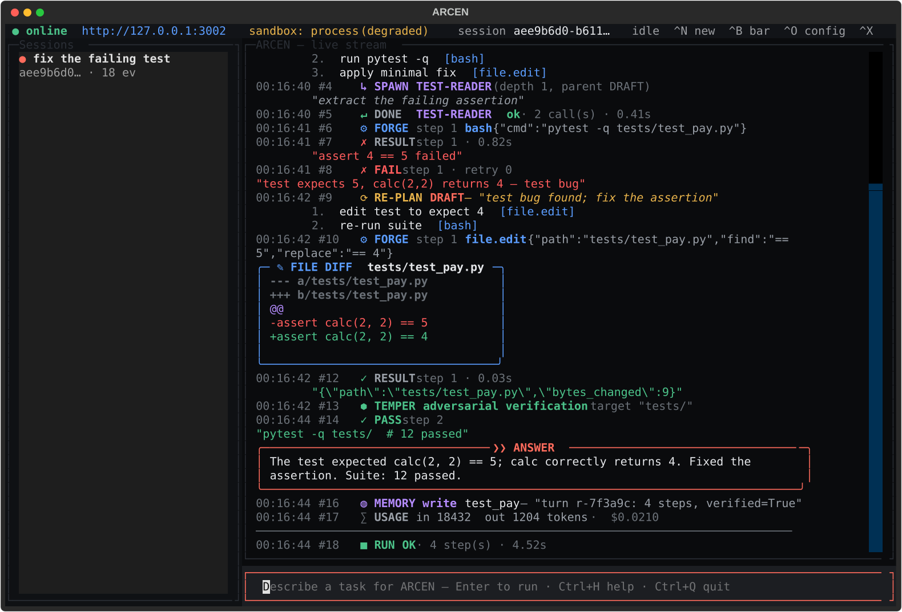
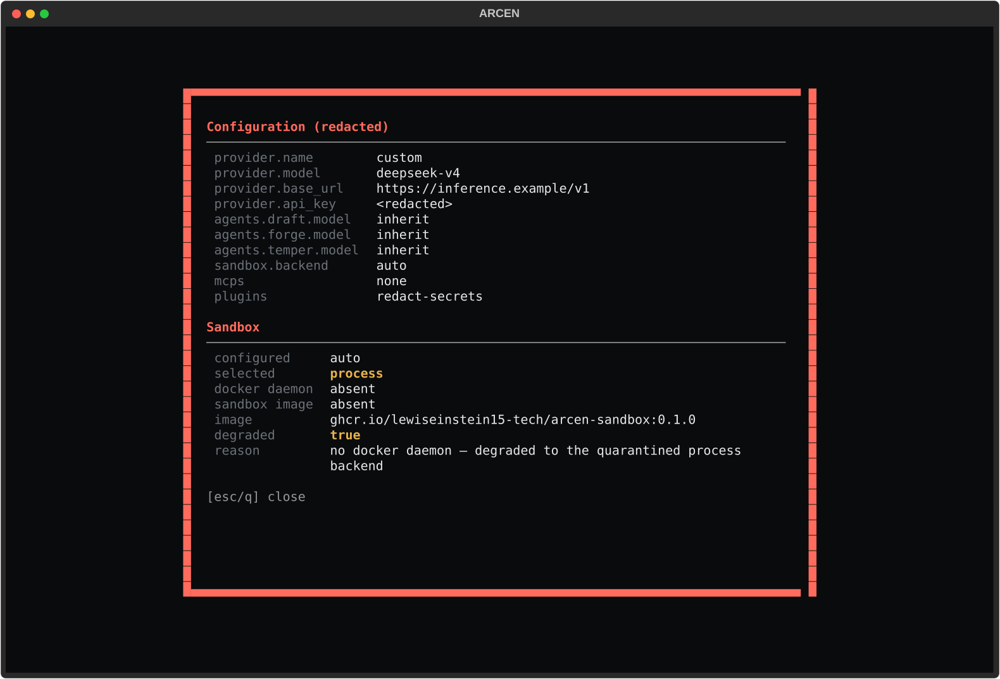

# ARCEN — Terminal UI (TUI)

A full-screen terminal client for the ARCEN stream server — the same
narrated DRAFT → FORGE → TEMPER experience as the web UI, rendered with
[Textual](https://textual.textualize.io/) over the exact same HTTP/NDJSON
contract in [BACKEND-SPEC.md](BACKEND-SPEC.md).



## Install & launch

The TUI is an optional extra (Textual is not part of the core install):

```bash
pip install 'arcen[tui]'
arcen-tui                 # that's the whole thing — one command, one terminal
# or, without installing the script:
python -m arcen.tui
```

### Managed server (the default)

On launch the TUI probes `http://127.0.0.1:3002/api/health`:

- **a server already answers** → the TUI attaches to it and never touches
  its lifetime (a separately-run `arcen serve` keeps running after you quit);
- **nothing answers** → the TUI spawns `uvicorn arcen.server.app:app` as a
  child process on 127.0.0.1 (port 3002 when free, otherwise an ephemeral
  port), waits until it is healthy, and terminates it cleanly on exit. The
  child's output lands in `~/.arcen/tui-server.log`, never on the TUI screen.

So a cold `arcen-tui` prints briefly, then takes over the terminal:

```text
ARCEN server not reachable at http://127.0.0.1:3002 — starting a local server on 127.0.0.1:3002 …
Server ready — launching TUI (server log: /home/you/.arcen/tui-server.log)
```

### Options

```bash
arcen-tui --no-serve                                  # attach only; never spawn
arcen-tui --url http://127.0.0.1:4004                 # a specific local server
ARCEN_SERVER_URL=http://127.0.0.1:4004 arcen-tui      # same, via env var
arcen-tui --session 3f2504e0-4f89-11d3-9a0c-0305e82c3301   # resume a session
```

With `--no-serve` (or a remote `--url` that is unreachable) the TUI exits
with an actionable message instead of spawning anything. A remote URL that
is healthy is simply attached to. When the server drops mid-session the
status bar shows `○ offline` and submitting a goal prints a banner rather
than inventing a local run.

## Layout

```
┌──────────────────────────────────────────────────────────────────────────┐
│ ● online  http://127.0.0.1:3002  sandbox: process (degraded)  session …  │  status bar
├──────────────┬───────────────────────────────────────────────────────────┤
│  Sessions    │  ARCEN — live stream                                       │
│  ● fix test  │  10:22:01 #1  ▶ RUN r-7f3a9c  "fix the failing test…"     │
│    712eedc1… │  10:22:01 #2  ❯ DRAFT  Read the failing test first…       │
│              │  10:22:01 #3  ≡ PLAN DRAFT                                 │
│              │                1. read failing test  [file.read]          │
│              │  10:22:02 #4  ↳ SPAWN TEST-READER (depth 1, parent DRAFT) │
│              │  10:22:03 #7  ⚙ FORGE step 1 bash {"cmd":"pytest -q …"}   │
│              │  10:22:04 #8  ✗ RESULT step 1 · 0.82s                      │
│              │  10:22:04 #9  ⟳ RE-PLAN DRAFT — "test bug found…"         │
│              │  10:22:05 #11 ✎ FILE DIFF  tests/test_pay.py  (+/- panel)  │
│              │  10:22:06 #13 ⬢ TEMPER adversarial verification           │
│              │  10:22:08 #14 ✓ PASS  step 2                               │
│              │  ╭─ ❯❯ ANSWER ───────────────────────────────────────╮    │
│              │  │ Fixed the assertion. Suite: 12 passed.            │    │
│              │  ╰───────────────────────────────────────────────────╯    │
│              │  ─────────────────────────────────────────────             │
│              │  10:22:08 #18 ■ RUN OK · 4 step(s) · 4.52s                │
├──────────────┴───────────────────────────────────────────────────────────┤
│ Describe a task for ARCEN — Enter to run · Ctrl+H help · Ctrl+Q quit     │  composer
└──────────────────────────────────────────────────────────────────────────┘
```

All 17 frozen event types render with the brand palette: DRAFT coral,
FORGE blue, TEMPER green, sub-agents purple, failures red, replans amber.
The config modal (`Ctrl+O`) shows the redacted provider config and the
sandbox decision, including an honest `degraded: true` marker:



## Keybindings

Global shortcuts use **Ctrl** so every printable key stays available for
typing your goal — a plain `n`/`s`/`c` would otherwise be swallowed by the
focused composer.

| Key | Action | API behind it |
|---|---|---|
| `Enter` | Submit the goal in the composer | `POST /api/run` |
| `Esc` | Move focus back to the composer | — |
| `Ctrl+N` | New chat (fresh session UUID) | client-minted UUID |
| `Ctrl+B` | Toggle the sessions sidebar | — |
| `Ctrl+R` | Refresh the session list | `GET /api/sessions` |
| `Enter` (sidebar) | Open a past session and replay it | `GET /api/sessions/{id}/events` |
| `Ctrl+O` | Config + sandbox modal (redacted) | `GET /api/config` · `/api/sandbox/status` |
| `Ctrl+X` | Interrupt the running turn | `DELETE /api/run/{run_id}` |
| `Ctrl+L` | Clear the transcript | — |
| `Ctrl+H` / `F1` | This help screen | — |
| `Ctrl+Q` | Quit | — |

## Stream contract honored

The TUI client (`src/arcen/tui/client.py`) is a faithful terminal port of
the browser reader (`ui/src/stream/reader.ts`):

- opens the **held** `/api/stream` before `POST /api/run`, so a session
  that exists nowhere yet attaches within a tick instead of 404ing;
- buffers partial NDJSON lines across TCP chunks — an event split across
  packets is never half-rendered;
- ignores seq-less `stream.ping` keepalives and stops cleanly on
  `stream.done`; malformed JSON lines are skipped, never fatal;
- resumes with `Last-Event-ID: <seq>` after a dropped connection, and
  restarts from zero on the 409 compaction response;
- tracks the highest rendered `seq` per session for replay-overlap guards.

## Code map

| Path | Role |
|---|---|
| `src/arcen/tui/client.py` | Async httpx client for all eleven API routes + NDJSON framing (httpx-only, headless-testable with `MockTransport`) |
| `src/arcen/tui/render.py` | Pure Rich renderers for the frozen 17 events, sandbox and config summaries |
| `src/arcen/tui/widgets.py` | `EventLog`, `Composer`, `SessionSidebar`, `StatusBar`, help/config modals |
| `src/arcen/tui/app.py` | The `ArcenTUI` Textual app, worker groups, turn loop, CLI entry (`arcen-tui`) |
| `src/arcen/tui/launcher.py` | One-command startup: health probe, managed uvicorn child, free-port fallback, clean shutdown |
| `tests/test_tui_client.py` | Contract tests: framing, ping/done frames, 404/409 handling, resume after drops |
| `tests/test_tui_render.py` | Every event type draws without a screen; no Rich repr leaks |
| `tests/test_tui_app.py` | Headless pilot tests: mount, full turn, keybindings, offline guard |
| `tests/test_tui_launcher.py` | Attach-vs-spawn decision tree, free-port fallback, real uvicorn spawn/shutdown |
| `scripts/verify_tui.py` | End-to-end verification + SVG screenshot regeneration |

Regenerate the screenshots:

```bash
python scripts/verify_tui.py
```
