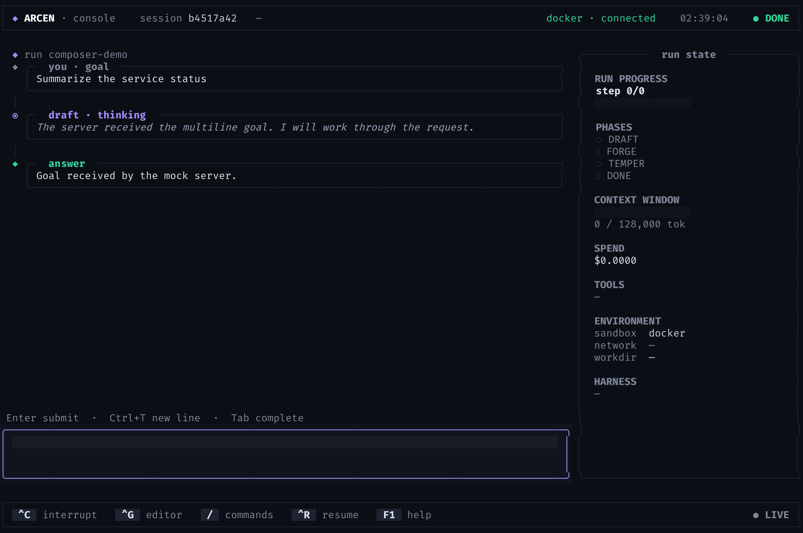
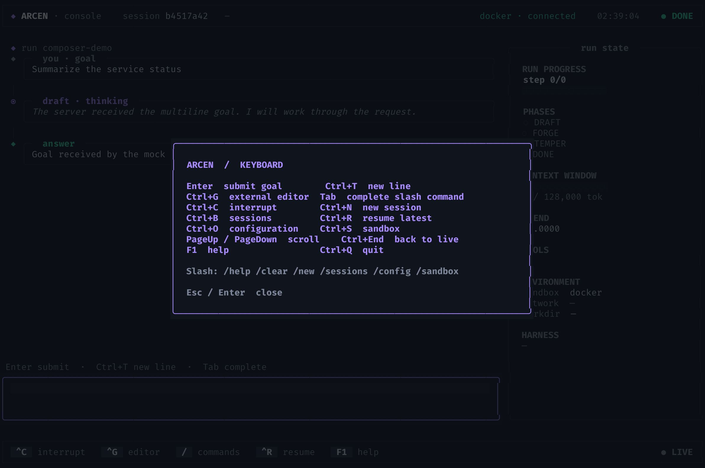

# ARCEN terminal UI

ARCEN's full-screen Textual client narrates the DRAFT → FORGE → TEMPER
stream from the same HTTP server used by the web UI. Its left spine shows
goals, thoughts, plans, commands, verification, answers and failures; the
right rail summarizes the current run. Below 100 columns the rail collapses
to leave room for the transcript and composer.



The screenshot is a **real PTY/xterm.js terminal capture** against a local,
deterministic mock HTTP server. It does not depict a model-generated run.
The [verification index](verify/README.md) distinguishes real-terminal
screenshots from headless test evidence.

## Install and launch

Install the optional extra in an isolated environment (for example, on
PEP 668 systems):

```sh
uv tool install 'arcen[tui]'
# or: pipx install 'arcen[tui]'
# or, from this checkout, in an activated virtual environment:
python -m pip install -e '.[tui]'
```

Launch the terminal UI:

```sh
arcen-tui
```

This is one command in one terminal. The launcher attaches to a healthy
server if one exists; otherwise it starts a local managed server, waits for
health, and stops only that child on exit. The managed child's log is
`~/.arcen/tui-server.log`. An already-running server is never stopped by the
TUI. See [the launcher](../src/arcen/tui/launcher.py) for its attach/spawn
rules.

```sh
arcen-tui --no-serve                       # attach only
arcen-tui --url http://127.0.0.1:4004      # explicit server
ARCEN_SERVER_URL=http://127.0.0.1:4004 arcen-tui
arcen-tui --session 3f2504e0-4f89-11d3-9a0c-0305e82c3301
arcen-tui --demo                  # scripted, no server or credentials
arcen-tui --demo --replay         # offline recorded server-event fixture
```

A real run requires a configured provider. The demos and local test servers
are not providers. `--no-serve` does not start a server. The interface shows
connection failures and retries, and keeps unsent drafts on failure.

## Compose and navigate

| Key | Action |
|---|---|
| `Enter` | Submit the composer goal |
| `Ctrl+T` | Insert a newline; modified Enter may also work in terminals that report it distinctly |
| `Tab` | Complete a unique slash-command prefix |
| `Ctrl+G` | Edit the draft using `$VISUAL` or `$EDITOR`; nonzero exit preserves the draft |
| `Ctrl+C` | Ask for confirmation before interrupting an active run |
| `Ctrl+N` | New session |
| `Ctrl+B` | Open/close the sessions drawer; select with arrows and Enter |
| `Ctrl+R` | Resume the newest saved session |
| `Ctrl+O` / `Ctrl+S` | Open configuration / sandbox status |
| `PageUp` / `PageDown` | Scroll narration while the composer has focus |
| `Ctrl+End` | Return to the live edge |
| `F1` | Open keyboard help |
| `Ctrl+Q` | Quit |
| `Esc` | Close a modal |

Slash commands are `/help`, `/clear`, `/new`, `/sessions`, `/config`, and
`/sandbox`. Session switching is blocked during an active run. `/clear`
clears the visible transcript, not the server's saved session. The config view masks API keys and strips credentials and query parameters
from displayed provider URLs. Press `E` in the configuration view to edit
provider name, model, endpoint, API key or sandbox backend, then explicitly
save. Leave the API key blank to keep it. If the server has other redacted
secrets that cannot be safely preserved by the PUT endpoint, saving is blocked;
use the web Settings interface or configuration file instead.



## Stream and safety details

The client opens a held NDJSON stream before submitting a goal, buffers partial
lines, ignores transport heartbeats, and resumes on disconnect using
`Last-Event-ID`. The adapter de-duplicates replayed sequence numbers and shows
an event-gap notice. HTTP 409 compaction triggers a replay from zero. The
server's `run.done` or `run.error` ends the stream for that turn. The client
also reports offline and degraded-sandbox states; the sandbox modal shows the
selected backend and reason. A degraded process backend is not the same as a
Docker container and should be assessed against your security requirements.

Interrupt sends `DELETE /api/run/{run_id}` **only after confirmation**. The
server cooperatively stops between steps, so an in-progress step may finish
first. Errors are shown without pretending the run stopped. No credentials are
needed for `--demo` or the fixture screenshots.

## Code and verification

| Path | Purpose |
|---|---|
| `src/arcen/tui/live.py` | Server-backed app, replay, reconnect and run lifecycle |
| `src/arcen/tui/composer.py` | Multiline composer and slash completion |
| `src/arcen/tui/adapter.py`, `state.py` | Frozen-event adapter and view state |
| `src/arcen/tui/cards/`, `views/` | Narration cards, scroll view and run-state rail |
| `src/arcen/tui/sessions.py`, `modals.py` | Session drawer and information / configuration modals |
| `src/arcen/tui/client.py`, `launcher.py` | HTTP/NDJSON contract and managed server lifecycle |
| `tests/test_tui_*.py` | Client, adapter, pilot, terminal and regression tests |
| `scripts/terminal_shot.py` | PTY → xterm.js → Chromium real-terminal capture |

To reproduce the offline demo screenshot after setting up the capture tools:

```sh
bash scripts/setup_terminal_shot.sh
python scripts/terminal_shot.py --cols 132 --rows 44 --wait 12 \
  --out docs/verify/my-demo.png -- arcen-tui --demo --replay
```

The capture script needs Playwright, Chromium, aiohttp, ptyprocess and the
xterm assets; it is development tooling, not a runtime dependency of ARCEN.

### Sandbox status

The sandbox modal reports **BLOCKED** when isolated tool execution is unavailable.
Docker and the configured local image are required; `process` is not an isolation
backend. Only bash is currently supported, in a disposable per-turn workspace.
A Docker availability indication is a preflight, not proof that a container has
started. See [Sandbox execution](../README.md#sandbox-execution).
