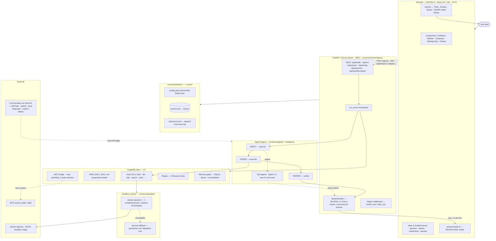
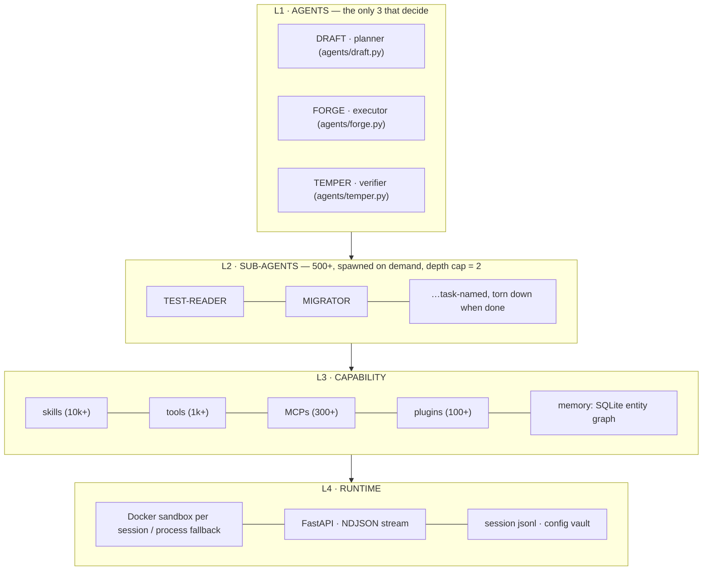
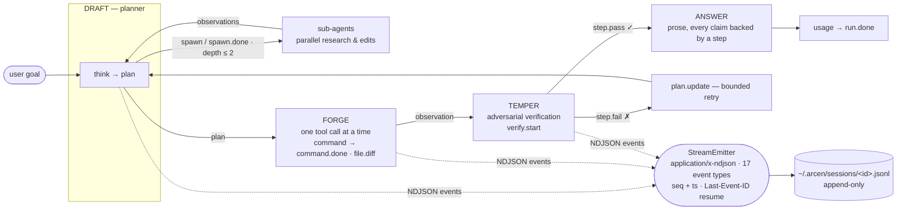
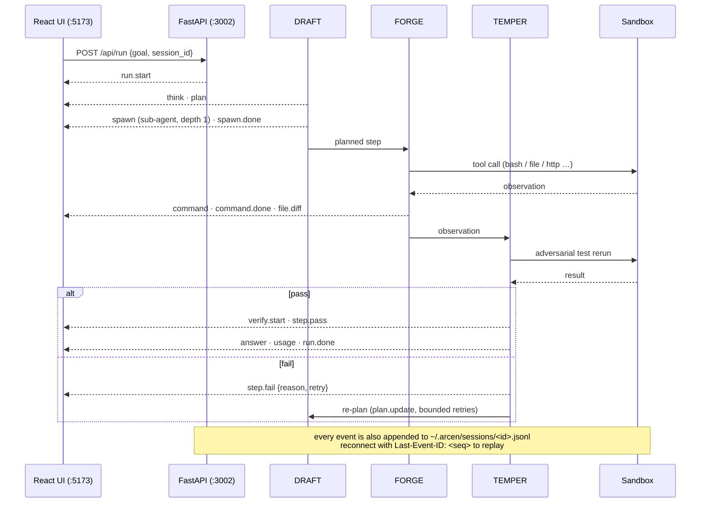
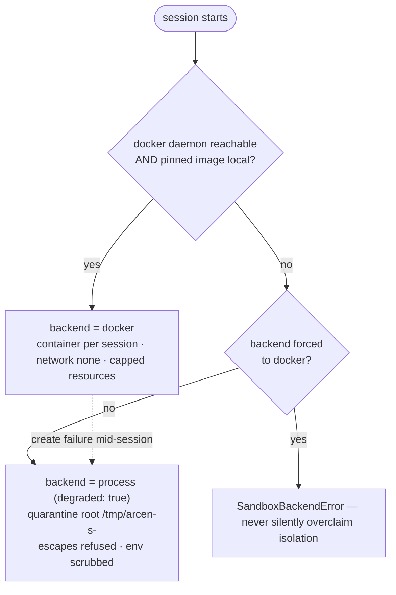

# ARCEN — Architecture Diagrams (Mermaid)

> Companion to [`ARCHITECTURE.md`](ARCHITECTURE.md). These diagrams render natively on GitHub and inside ARCEN's own Markdown view (`ui/src/markdown/Mermaid.tsx`). A dependency-free visual version is in [`architecture-diagram.html`](architecture-diagram.html).

## 1. System & deployment view

## 2. The four-layer architecture

## 3. Agent turn loop & event flow

## 4. Sequence of one streamed turn

## 5. Sandbox backend selection

